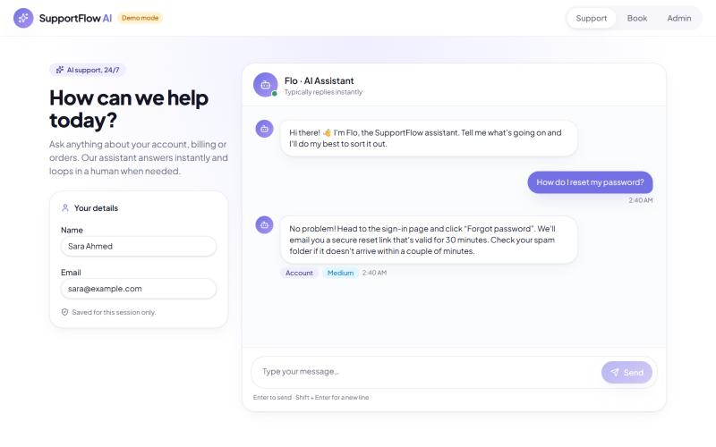
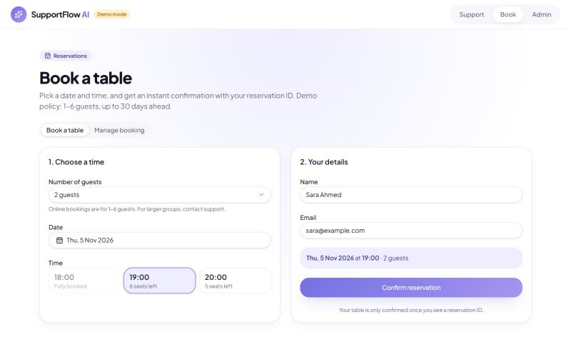
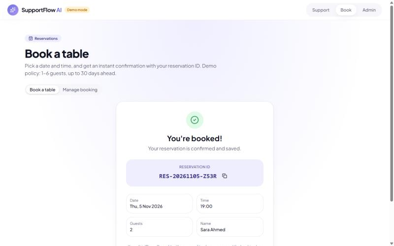
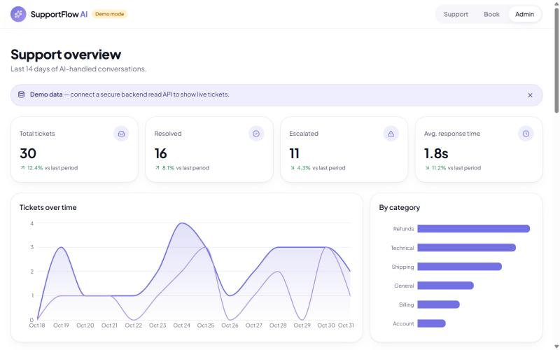
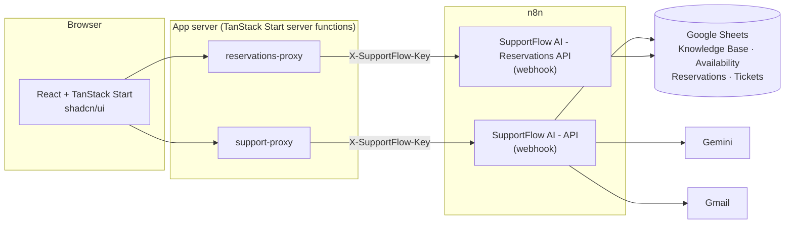
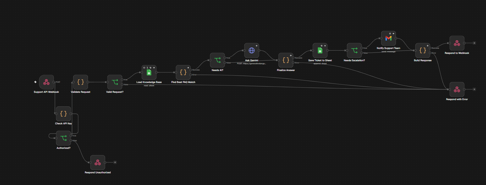
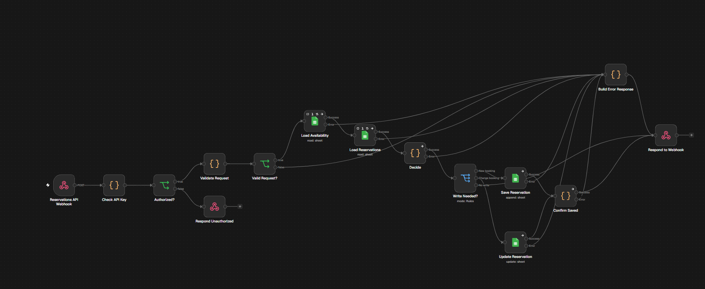

# SupportFlow AI

An AI-powered customer support and reservations platform. A React frontend talks to
**n8n** automation workflows through secure server-side proxies; n8n answers questions
from a Google Sheets knowledge base (with a Gemini fallback), logs every ticket,
escalates to the support team by Gmail, and manages table reservations.

> All business policies in the knowledge base and reservation rules are **fictional demo
> policies** created for this portfolio project.

**Try it**

- **Live version (real AI backend):** https://supportflow-ai.supportflow-ai.workers.dev –
  answers come from the n8n workflows, the knowledge base and Gemini. Protected by a one-time
  bot check; uses demo copies of the Google Sheets and never sends emails.
- **Demo mode:** https://roaalhejaili.github.io/supportflow-ai/ – in-browser mock data only,
  no backend calls.

## Screenshots

Taken in **demo mode** (in-browser mock data, no backend). With the live backend, chat
answers come from the n8n workflow and knowledge base, so their wording differs.

| Support chat | Booking |
| --- | --- |
|  |  |
| **Booking confirmation** | **Admin dashboard (demo data)** |
|  |  |

## Features

**Customer support chat**
- Direct answers from a 22-entry FAQ knowledge base when one FAQ clearly matches
- Gemini fallback for unclear or multi-part questions, grounded **only** in matching FAQs
- Partial answers: covered parts are answered, the rest is escalated (never a false "resolved")
- Sensitive topics (refund requests, charges, legal, complaints) always go to a person
- Every valid request is logged to Google Sheets; escalations email the team via Gmail

**Reservations**
- Live availability by date with seats left per time slot
- Booking with validation, capacity checks and duplicate-booking prevention
- Confirmation with a unique reservation ID, shown **only after the booking is saved**
- Look up, modify or cancel a booking with reservation ID + email (24-hour cutoff)

**Admin dashboard** – ticket KPIs, charts, filters and a ticket details panel. It uses
built-in demo data and is not yet connected to the Tickets sheet.

## Architecture



- The browser never sees the webhook URLs or the shared secret; they live in server-side
  environment variables and are sent by the proxies in the `X-SupportFlow-Key` header.
  The first node of each workflow compares a SHA-256 hash of that header with a stored
  hash, so the key itself is never stored in n8n. Wrong or missing keys get `401`.
- Responses are validated with **zod** on the server and again in the browser.
- **Demo mode** (default) swaps both backends for in-browser mocks, so the whole UI works
  without n8n. The reservations mock follows the same rules as the real workflow; the chat
  mock returns canned replies and does not reproduce the real routing or escalation logic.

## n8n workflows

| Workflow | Trigger | What it does |
| --- | --- | --- |
| SupportFlow AI | Form | Original form-based workflow (kept in n8n, not part of this repo) |
| SupportFlow AI - API | `POST /webhook/supportflow-ai-api` | Validate → load KB → match FAQ → (Gemini) → log ticket → (Gmail) → JSON |
| SupportFlow AI - Reservations API | `POST /webhook/supportflow-reservations` | Validate → load Availability + Reservations → decide → (one sheet write) → JSON |
| … (public demo) copies | `POST /webhook/…-public` | Same logic for the public live demo: own key, demo Sheet copies, no Gmail step |

Code node sources, the SDK workflow definitions and tests live in [`n8n/`](n8n/).

**Support API** – key check → validation → knowledge base → FAQ match → Gemini only when needed →
ticket logged → Gmail only for escalations → JSON reply.



**Reservations API** – key check → validation → read Availability and Reservations → decide
(capacity, duplicates, 24-hour rule) → one sheet write → confirm only after it is saved.



### Support API

Request
```json
{ "customer_name": "Sara Ahmed", "customer_email": "sara@example.com", "original_message": "What are your opening hours?" }
```
Response `200`
```json
{
  "success": true,
  "customer_reply": "Demo hours: every day, 9:00 AM to 9:00 PM, local time.",
  "category": "Hours",
  "priority": "low",
  "requires_human": false,
  "resolution_status": "resolved",
  "ticket_id": null,
  "ticket_logged": true,
  "escalation_notified": false,
  "warnings": []
}
```
Errors: `401 unauthorized` (missing or wrong key), `400 invalid_request` (with `details`),
`500 processing_failed`. An escalation is only reported as successful if Gmail accepted the
team notification. `ticket_id` is always `null`: the Tickets sheet has no ID column, and the
API never invents one.

### Reservations API

All requests are `POST` with an `action`:

| action | fields |
| --- | --- |
| `availability` | `date?`, `guests?` |
| `create` | `customer_name`, `customer_email`, `date`, `time`, `guests` |
| `lookup` / `cancel` | `reservation_id`, `customer_email` |
| `modify` | `reservation_id`, `customer_email`, `date`, `time`, `guests` |

Success: `{ "success": true, "reservation": { "reservation_id": "RES-20261103-K7QX", ... }, "message": "..." }`

Errors: `{ "success": false, "error": { "code", "message", "details?", "alternatives?" } }` with codes
`unauthorized` (401), `invalid_request` (400), `no_change` (400), `not_found` (404), `slot_unavailable`, `slot_not_offered`,
`duplicate_booking`, `too_late`, `already_cancelled` (409), `booking_not_saved`, `change_not_saved`,
`service_unavailable` (503).

### Design decisions

- **Key check inside the workflow.** The Webhook node's *Ignore Bots* option rejects every
  server-to-server call (curl, Node and axios user agents) with a misleading
  `403 Authorization data is wrong!`, so it is off. The key is verified by a `Check API Key`
  Code node against a SHA-256 hash (`n8n/check_api_key.js`; `build.py` reads `N8N_KEY_SHA256`).

- **One source of truth.** Seats left = `Capacity − Booked Count − confirmed online bookings`.
  `Booked Count` in the Availability tab represents seats taken offline (e.g. phone bookings);
  online bookings are counted from the Reservations tab. Each action therefore needs at most
  **one** sheet write, so the two tabs can't drift apart.
- **Never confirm unsaved data.** The confirmation and reservation ID are returned only after
  Google Sheets returns the written row. A failed write returns `booking_not_saved`.
- **Privacy.** Lookups require the reservation ID *and* the booking email; a wrong email gets
  the same `not_found` response as a wrong ID.
- **Cheap where possible.** Gemini is only called when a direct FAQ match isn't sufficient.

## Known limitations

- **Double-booking race.** Google Sheets has no transactions, so two simultaneous requests for
  the last seats could both pass the capacity check. A database with row locking (or a queue
  in front of the workflow) would remove this race.
- **Admin dashboard uses demo data.** It is not connected to the Tickets sheet and has no login.
- **No ticket IDs.** The Tickets sheet has no ID column, so `ticket_id` is always `null`.
- **Modifying a booking is not verified live.** It is covered by the local logic tests only
  (see [Testing](#testing)).
- **Public demo rate limit is best-effort.** It is kept in memory per Cloudflare instance; the
  Turnstile check is the main protection.
- **Fictional policies.** Hours, refund rules and reservation policies are demo content.

## Getting started

```bash
npm install
npm run dev        # open the URL Vite prints – runs in demo mode
```

To use the real n8n backend, copy `.env.example` to `.env` and fill in:

```
VITE_USE_MOCK_API=false
N8N_WEBHOOK_URL=https://<your-n8n>/webhook/supportflow-ai-api
N8N_RESERVATIONS_URL=https://<your-n8n>/webhook/supportflow-reservations
N8N_WEBHOOK_SECRET=<a long random key; its SHA-256 goes in the Check API Key nodes>
```

Only `VITE_USE_MOCK_API` reaches the browser; the other values are read by the server-side
proxies. The n8n workflows must be **published** (active) for the production URLs to work.

The committed workflow files in `n8n/*/workflow.ts` contain only placeholders (Sheet IDs,
credential IDs, support inbox, API key hash). To recreate the workflows, fill in the optional
`N8N_*` build values in `.env` and run:

```bash
npm run build:n8n:local   # writes n8n/*/workflow.local.ts (git-ignored) with your values
```

Then import the output with n8n's Workflow SDK tooling. Only the SHA-256 hash of
`N8N_WEBHOOK_SECRET` is written, never the key itself.

## Testing

```bash
npm run test:n8n    # FAQ routing (28 cases) + reservation logic (20 cases), runs the real Code node sources
npm run check:n8n   # live connectivity check against both webhooks (needs .env; makes no writes)
npm run build
```

**Automated (local):** 28/28 FAQ routing cases and 20/20 reservation cases pass (the
reservation cases include modifications).

**Simulated in n8n** (pinned Google Sheets, Gemini and Gmail data, no real emails):
successful booking, unavailable slot, duplicate booking, invalid date, lookup,
cancellation, and Google Sheets read/write failures (a failed save is never confirmed).

**Verified live** (real n8n workflows and Google Sheets, through the local app):

| Scenario | Result |
| --- | --- |
| Wrong or missing API key | `401` from both webhooks |
| Invalid support request | `400 invalid_request` with details, before any ticket is logged |
| Availability | Real slots and seats left from the Availability and Reservations tabs |
| Book → look up → cancel | Row saved with the returned reservation ID; lookup by ID + email; status set to Cancelled; seats restored |
| FAQ question | Answered directly from the matching FAQ (no Gemini call), ticket logged, no email |
| Question with no matching FAQ | Escalated: ticket logged and team notified by Gmail |
| Two-part question | Answered by Gemini using only the two matching FAQs, resolved, no email |

**Verified on the public live demo** (Cloudflare Worker → public n8n copies → demo Sheets):

| Scenario | Result |
| --- | --- |
| Request without passing the bot check | Refused by the server (`human_check`); nothing reaches n8n |
| Request from another site | Refused by TanStack Start's same-origin protection |
| Private key used on the public webhooks | `401` – the public copies have their own key |
| FAQ and Gemini questions after the check | Answered; tickets logged in the demo Sheet only, no email |
| Browser code | Contains no keys, n8n URLs or server-only code |

### Public demo (GitHub Pages)

```bash
npm run build:pages   # static demo build in dist/client, served from /supportflow-ai/
```

The demo build is a static single-page app with demo mode forced on and no server output, so
the n8n proxies are not deployed. The script fails if the output is not in demo mode or contains
any n8n URLs, header names or the local API key. `.github/workflows/pages.yml` runs the tests
and this build on every push to `main` and deploys `dist/client` to GitHub Pages (no secrets).

### Public live demo (Cloudflare Workers)

```bash
npm run deploy:live -- --dry-run   # build and run the safety checks without uploading
npm run deploy:live                # build in live mode and deploy the Worker
```

The full app (including the server-side proxies) runs on Cloudflare's free Workers plan and
talks to the **public demo** copies of the n8n workflows (`npm run build:n8n:public`), which
have their own key, use demo copies of the Google Sheets and have no Gmail step.

- **Secrets** live only in Cloudflare (`wrangler secret put`): `N8N_WEBHOOK_URL`,
  `N8N_RESERVATIONS_URL`, `N8N_WEBHOOK_SECRET` (the public key) and `TURNSTILE_SECRET_KEY`.
- **Bot check:** one Cloudflare Turnstile check per visit; the server verifies it and sets a
  signed, HttpOnly cookie for 2 hours. Chat and reservation calls without it are refused.
- **Rate limit:** 15 support messages and 60 reservation calls per visitor per 10 minutes.
- **Banner:** visitors are told it is a demo with fictional policies and no emails.
- The deploy script blocks the upload if any key, n8n URL or server-only code would reach the
  browser files. Without the Turnstile settings (local development, GitHub Pages) none of this
  is active.

## Project structure

```
src/
  routes/                 index (support chat), book (reservations), admin
  components/support/     chat UI
  components/reservations/ booking form, manage booking, date/time pickers
  components/admin/       dashboard + ticket panel
  services/               API clients, server-side proxies (*.functions.ts), demo mocks,
                          public-demo guard (bot check + rate limit)
  types/                  zod schemas and types
n8n/
  support-api/            Code nodes, KB snapshot, routing tests, workflow template
  reservations-api/       Code nodes, reservation tests, workflow template
  check_api_key.js        API key check (SHA-256) used as the first node of both workflows
  build.py                regenerates the importable SDK workflow code
scripts/check-n8n.mjs     live connectivity check
scripts/build-pages.mjs   static demo build for GitHub Pages (with safety checks)
scripts/deploy-live.mjs   public live demo build + deploy to Cloudflare (with safety checks)
.github/workflows/        GitHub Pages deployment
docs/screenshots/         README screenshots
```

## Tech stack

React 19, TypeScript, TanStack Start/Router/Query, Tailwind CSS v4, shadcn/ui, zod,
Recharts · n8n, Google Sheets, Google Gemini, Gmail.

## Development

The UI (support chat, admin dashboard, design system) was scaffolded with
[Lovable](https://lovable.dev). The reservations feature, server-side proxies, n8n workflows,
knowledge-base routing, tests and live integration were built afterwards with AI-assisted
development (Claude Code).

## License

[MIT](LICENSE) © 2026 Roaa Alhejaili
